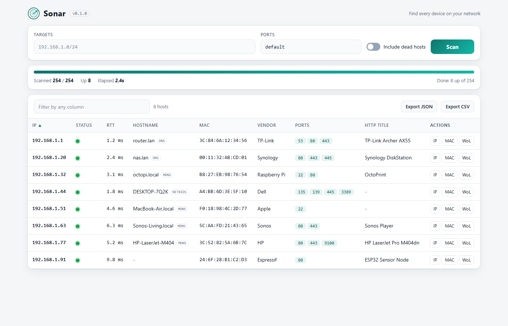

<div align="center">

# Sonar

**Fast, single-binary LAN scanner. No install, no admin, no runtime.**

[](https://github.com/Xoltox/sonar/actions/workflows/ci.yml)
[](https://github.com/Xoltox/sonar/releases/latest)
[](go.mod)
[](LICENSE)
[](#install)

<picture>
  <source media="(prefers-color-scheme: dark)" srcset="docs/screenshot-web.png">
  
</picture>

</div>

Sonar is an open-source, cross-platform alternative to Advanced IP Scanner. It
ships as one small binary (about 5 to 8 MB) per operating system and finds
devices on your network along with their IP addresses, hostnames, MAC
addresses, hardware vendors, open ports and web page titles. Use it from the
command line, or open the built-in web UI.

## Features

- **Automatic discovery.** Detects the local subnets on your machine and skips
  virtual adapters. With no arguments, it scans everything it finds.
- **Three alive checks in parallel.** ICMP echo, TCP connect and ARP race each
  other per host, and the first proof of life wins.
- **No admin or root required** on Windows, macOS and Linux.
- **MAC address and vendor.** Vendor names come from an embedded copy of the
  IEEE OUI registry.
- **Names.** Reverse DNS, NetBIOS and mDNS, with the source shown for each name.
- **Port check.** Scans 21, 22, 23, 53, 80, 135, 139, 443, 445, 3389, 5900,
  8080 and 8443 by default. Choose your own list or range with `--ports`.
- **HTTP titles.** Shows the `<title>` of each host's web page.
- **Output formats.** Aligned table, JSON or CSV, suitable for scripts.
- **Web UI.** Live results while the scan runs, sorting and filtering, one-click
  links to http, https, ssh, rdp, smb, vnc and ftp, Wake-on-LAN, and JSON or CSV
  export.
- **Wake-on-LAN.** Send a magic packet from the UI or with `sonar wol`.
- **Fast.** A /24 finishes in about one second on a typical LAN.
- **Small dependency set.** Only the Go standard library plus `golang.org/x/sys`
  and `golang.org/x/net`. Builds are CGO-free and produce static binaries.

## Install

Download the binary for your system from the
[latest release](https://github.com/Xoltox/sonar/releases/latest):

| Platform | File |
| --- | --- |
| Windows (x64) | `sonar-windows-amd64.exe` |
| Windows (ARM64) | `sonar-windows-arm64.exe` |
| Linux (x64) | `sonar-linux-amd64` |
| Linux (ARM64) | `sonar-linux-arm64` |
| macOS (Intel) | `sonar-darwin-amd64` |
| macOS (Apple Silicon) | `sonar-darwin-arm64` |
| macOS (universal) | `sonar-darwin-universal` |

Each release includes a `SHA256SUMS` file. To verify a download:

```sh
sha256sum -c SHA256SUMS --ignore-missing     # Linux
shasum -a 256 -c SHA256SUMS --ignore-missing # macOS
```

On Windows, compare the hash with `Get-FileHash sonar-windows-amd64.exe`.

Platform notes:

- **Windows.** Double-clicking the downloaded `.exe` starts the web UI and opens it in your
  browser. SmartScreen may warn that the binary is unsigned. Click **More info**,
  then **Run anyway**.
- **macOS.** Make the binary executable and remove the download quarantine flag:

  ```sh
  chmod +x sonar-darwin-universal
  xattr -d com.apple.quarantine sonar-darwin-universal
  ```

- **Linux.** Make the binary executable with `chmod +x sonar-linux-amd64`. If the
  kernel blocks ICMP for unprivileged users, Sonar falls back to TCP and ARP, so
  scans still work. To enable ICMP, run:

  ```sh
  sudo sysctl -w net.ipv4.ping_group_range="0 2147483647"
  ```

You can also install with Go 1.26 or newer:

```sh
go install github.com/Xoltox/sonar@latest
```

## Usage

Scan every local subnet:

```sh
sonar
```

Scan a subnet, an address range or a single host:

```sh
sonar 192.168.1.0/24
sonar 10.0.0.1-10.0.0.50
sonar 10.0.0.1-50
sonar 192.168.1.5
```

Choose the ports to check on live hosts:

```sh
sonar --ports 22,80,443 10.0.0.1-10.0.0.50
sonar --ports none 192.168.1.0/24
```

Show hosts that did not respond, and produce machine-readable output:

```sh
sonar --all 192.168.1.0/24
sonar --json 192.168.1.0/24 > scan.json
sonar --json 192.168.1.0/24 | jq '.[] | select(.alive) | .ip'
sonar --csv 192.168.1.0/24 > scan.csv
```

Web UI:

```sh
sonar serve                 # 127.0.0.1:8080
sonar serve --open          # also opens your browser
sonar ui                    # random loopback port, opens your browser
sonar serve 0.0.0.0:8080    # listen on the network (see Web UI security)
```

Wake-on-LAN and version:

```sh
sonar wol AA:BB:CC:DD:EE:FF
sonar version
```

Sample table output (demo data):

```text
IP            STATUS  RTT   HOSTNAME      MAC                VENDOR        PORTS             HTTP TITLE
192.168.1.1   up      1ms   router.lan    3C:84:6A:12:34:56  TP-Link       53,80,443         TP-Link Archer AX55
192.168.1.20  up      2ms   nas.lan       00:11:32:AB:CD:01  Synology      80,443,445        Synology DiskStation
192.168.1.32  up      3ms   octopi.local  B8:27:EB:98:76:54  Raspberry Pi  22,80             OctoPrint
192.168.1.44  up      2ms   DESKTOP-7Q2K  A4:BB:6D:3E:5F:10  Dell          135,139,445,3389
192.168.1.91  up      10ms                24:6F:28:B1:C2:D3  Espressif     80                ESP32 Sensor Node
```

Progress and the summary line go to stderr, so redirecting stdout keeps the
output clean. Dead hosts are hidden unless you pass `--all`.

### Flags

| Flag | Default | Description |
| --- | --- | --- |
| `--timeout` | `800ms` | Per-probe timeout |
| `--concurrency` | `256` | Number of hosts scanned in parallel |
| `--ports` | `default` | Ports to scan on live hosts: a list, ranges, `default` or `none` |
| `--all` | off | Also show hosts that did not respond |
| `--json` | off | JSON output |
| `--csv` | off | CSV output |
| `--no-color` | off | Disable colored output |
| `--force` | off | Allow scanning more than a /16 |
| `--serve` | | Start the web UI on the given address instead of scanning |
| `--open` | off | Open the web UI in the default browser (with `serve` or `--serve`) |

`sonar serve` and `sonar ui` also accept `--timeout`, `--concurrency`, `--ports`
and `--open`. Run `sonar help` for the full usage text.

## How it works

Each host goes through two stages.

1. **Alive check.** ICMP, TCP and ARP run in parallel. The first one to prove the
   host is up wins, and the others are cancelled. Hosts that answer none of them
   are reported as down.
2. **Enrichment.** For each live host, Sonar looks up the MAC and vendor, resolves
   names, checks the ports and fetches the HTTP title. These run in parallel.

Alive checks by operating system:

| Probe | Windows | macOS | Linux |
| --- | --- | --- | --- |
| ICMP echo | `IcmpSendEcho2` | Unprivileged ICMP datagram socket | Unprivileged ICMP datagram socket |
| ARP | `SendARP`, plus the IP neighbor table | Routing table (`sysctl` NET_RT_FLAGS) | Neighbor cache over netlink |
| TCP connect | Connect to common ports | Connect to common ports | Connect to common ports |

A refused TCP connection (RST) also proves that the host is up, even if no
service is listening.

Enrichment on every platform:

| Data | Method |
| --- | --- |
| Hostname | Reverse DNS, then NetBIOS node status (UDP 137), then mDNS (UDP 5353) |
| MAC address | ARP and the OS neighbor cache, then NetBIOS as a fallback |
| Vendor | Embedded IEEE OUI table, looked up by the MAC prefix |
| Open ports | TCP connect to the port list |
| HTTP title | Fetches the page title from the open web ports |

## Web UI security

The web UI can start scans and send Wake-on-LAN packets, so it is locked down by
default:

- It binds to `127.0.0.1` unless you choose another address.
- Every API request must carry a per-process token. The token is generated at
  startup and embedded in the page that the UI serves.
- Only requests with an allowed `Host` header are accepted.
- Cross-site requests are rejected.

If you bind to a network address with `sonar serve 0.0.0.0:8080`, Sonar prints a
warning. The UI has no user authentication, so anyone who can reach that address
can run scans and send Wake-on-LAN packets. Only do this on a network you trust.

## Build from source

Requirements: Go 1.26 or newer.

```sh
git clone https://github.com/Xoltox/sonar.git
cd sonar
make all          # builds every release binary into dist/
```

On Windows, run `./build.ps1` instead.

Run the tests:

```sh
go test ./...
```

To refresh the embedded vendor table from the IEEE registry:

```sh
go generate ./internal/oui
```

## Responsible use

Sonar sends network probes and connection attempts to every host it scans. Only
scan networks that you own or administer, or that you have written permission to
scan. Sonar does not perform stealth or SYN scanning. Scans larger than a /16
are refused unless you pass `--force`.

To report a security issue, see [SECURITY.md](SECURITY.md).

## License

Sonar is released under the [MIT License](LICENSE).
Copyright (c) 2026 Parth Sharma.
